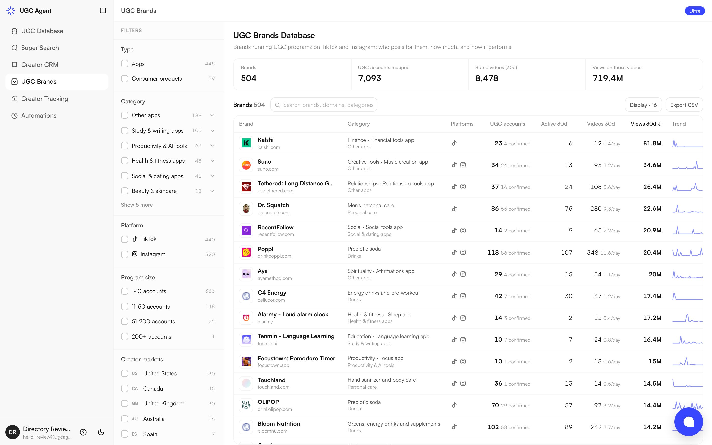

<p align="center"></p>

# UGC Agent MCP Server

**Give your agents the best data to grow your UGC program.**

UGC Agent is a data hub for paid UGC (content creators make for brand ads and brand-owned accounts). This hosted, remote MCP server gives Claude, ChatGPT, Cursor, Codex and any MCP client the same data and tools as [app.ugcagent.app](https://app.ugcagent.app):

- **UGC Database:** search 28,000+ Instagram and TikTok UGC creators with public emails, filtered by niche, country, gender, follower band, portfolio, brand-collab experience and proven UGC hit rate.
- **Creator sourcing from a brief:** "find 30 US skincare UGC creators on TikTok with 5k-50k followers and an email" runs our sourcing agent across the creator index plus live Instagram and TikTok discovery, then qualifies every creator.
- **UGC Brands:** 500+ brands running UGC programs, the creators behind them and how their videos perform. Find creators with a verified post for a specific brand.
- **Creator CRM:** stages, notes, tasks, lists, CSV export, and handoff to Instantly or Smartlead campaigns. Review creator applications and draft outreach.
- **Creator Tracking:** follow creators' videos and report views and engagement over time.
- **Automations:** recurring creator-lead deliveries and UGC trend reports.



## Connect

| | |
|---|---|
| Endpoint | `https://mcp.ugcagent.app/mcp` |
| Transport | Streamable HTTP (remote, hosted) |
| Auth | OAuth 2.1 with PKCE and dynamic client registration. API keys (`Authorization: Bearer ugc_live_...`) also work for headless agents. |
| Plan | MCP access needs a Premium, Ultra or Enterprise plan. Every plan starts with a 3-day trial: [pricing](https://ugcagent.app/pricing/). |
| Registry | `io.github.VicPitic/ugc-agent` in the [Official MCP Registry](https://registry.modelcontextprotocol.io) |

**Claude (web/desktop):** Settings > Connectors > Add custom connector > `https://mcp.ugcagent.app/mcp`, then sign in.

**Claude Code**
```bash
claude mcp add --transport http ugcagent https://mcp.ugcagent.app/mcp
```

**Codex**
```bash
codex mcp add ugcagent --url https://mcp.ugcagent.app/mcp && codex mcp login ugcagent
```

**Cursor, VS Code, Windsurf and other JSON configs**
```json
{
  "mcpServers": {
    "ugcagent": { "url": "https://mcp.ugcagent.app/mcp" }
  }
}
```

**Clients that only speak stdio**
```json
{
  "mcpServers": {
    "ugcagent": { "command": "npx", "args": ["-y", "mcp-remote", "https://mcp.ugcagent.app/mcp"] }
  }
}
```

## Example prompts

1. Find 25 US-based fitness UGC creators on TikTok with 5k-50k followers and a contact email.
2. Which creators have made UGC for Cal AI, and what were their best videos?
3. Show me skincare brands running UGC programs on TikTok and who creates for them.
4. Save these creators to my CRM in the Outreach stage and send them to my Instantly campaign.
5. How did my tracked creators' videos perform this week?

## Tools (70)

Read-only tools carry `readOnlyHint`; tools that change or delete data carry `destructiveHint` and ask for confirmation before writing.

| Tool | Type | What it does |
|---|---|---|
| `get_agent_context` | read-only | Return auth mode, plan, usage, preferences, service config, and operating instructions. |
| `run_ugc_agent` | write | Run a full UGC Agent sourcing/refine/export turn on the web app's search engine |
| `research_company` | read-only | Research a brand/product/company so the LLM can derive niche and creator-search angles |
| `find_brand_creators` | write | Content-first search for creators who ALREADY made content for specific brands ('worked with Cal AI'): searches Instagram posts tagging the brand, bra |
| `analyze_seed_creators` | write | Analyze example Instagram creators to derive criteria before sourcing similar creators. |
| `discover_creators` | write | Search Instagram + TikTok for creator candidates and queue them for enrichment |
| `enrich_and_score` | write | Enrich queued candidates or specific Instagram handles, then keep only qualified on-niche creators with emails (unless the user's accept-no-email pref |
| `list_leads` | read-only | Return full kept lead rows for this MCP conversation. |
| `remove_leads` | destructive | Remove kept leads by exact handle. |
| `export_csv` | read-only | Return a CSV of kept leads plus an app_url for table review/export |
| `draft_creator_outreach` | read-only | Draft short, direct outbound copy (DM and/or email) for contacting a creator |
| `analyze_creator_content` | read-only | Fetch recent posts for kept creators, compute per-creator virality (max views relative to followers), rank them, and return each creator's top videos  |
| `find_viral_trends` | read-only | Collect evidence-backed current TikTok/Instagram posts and grounded web sources, then return 1-5 validated trends with proof links, observations, and  |
| `ideate_ugc_content` | read-only | Generate structured UGC video ideas by crossing a library of proven short-form formats (problem→solution, before/after, unboxing, myth-busting, trend  |
| `draft_ugc_script` | read-only | Draft a timed short-form UGC video script: hook (0-3s), body scenes with time ranges + shot directions + draft voiceover + on-screen text, CTA, captio |
| `list_automations` | read-only | List the authenticated user's lead-sourcing and trend-research automations with lifecycle state and recent status |
| `create_lead_automation` | write | Collect explicit values one missing field at a time in the returned order: criteria or Agent Preferences, lead_count, frequency, conditional weekday/d |
| `create_trend_research_automation` | write | Collect explicit values one missing field at a time in the returned order: topic, platform, frequency, conditional weekday/day_of_month, exact daily_t |
| `update_automation` | write | Explicit two-phase write; never infer or default configurable values |
| `update_trend_research_automation` | write | Explicit two-phase write; never infer or default configurable values |
| `pause_automation` | write | Pause an owned automation without canceling active runs or pending deliveries |
| `resume_automation` | write | Resume an owned paused automation and schedule its next normal frequency-aware occurrence |
| `run_automation_now` | write | Make an owned active automation due immediately for the Railway scheduler |
| `list_automation_runs` | read-only | List normalized run history for an owned lead-sourcing or trend-research automation |
| `get_automation_run` | read-only | Poll one owned automation run for status, progress, errors, delivery state, and trend results. |
| `get_run_status` | read-only | Poll a search started by run_ugc_agent on the web app |
| `stop_run` | write | Stop a search that run_ugc_agent started on the web app, by list_id |
| `list_chats` | read-only | List the user's chats as they appear in the app.ugcagent.app sidebar (web chats and searches started from this MCP), newest first, with each chat's id |
| `rename_chat` | write | Rename one of the user's chats |
| `test_automation_delivery` | write | Send the fixed-sample branded lead-automation email directly through Resend |
| `retry_automation_delivery` | write | Reset an eligible succeeded or partial lead or trend-research run with failed delivery to pending so Railway retries it on the next cron tick |
| `preview_automation_deletion` | read-only | Read-only deletion preview |
| `delete_automation` | destructive | Destructive and idempotent soft-delete |
| `reset_conversation` | destructive | Clear queued candidates, processed handles, seed criteria, and kept leads for an MCP conversation. |
| `list_crm_leads` | read-only | List creators saved in the user's Creator CRM (every creator they kept from searches, automations and UGC Database unlocks) with pipeline stage, deal  |
| `get_crm_overview` | read-only | Creator CRM pipeline summary plus the user's custom CRM lists: creators per stage, how many are in conversation or working with the user, committed de |
| `save_creator_to_crm` | write | Save one creator from the UGC Database into the user's Creator CRM by platform and handle (the app's unlock) |
| `update_crm_lead` | write | Move a CRM creator through the pipeline (sourced, contacted, replied, negotiating, hired, creating, delivered, paid, declined = not a fit) or edit dea |
| `remove_crm_lead` | destructive | Permanently remove a creator from the user's Creator CRM, including its notes, tasks and deal terms |
| `manage_crm_notes_and_tasks` | destructive | Work on one CRM creator's record: add_note / edit_note / delete_note (body, note_id), add_task (title, optional due_at as YYYY-MM-DD or ISO time; a ba |
| `export_crm_csv` | read-only | Export Creator CRM creators as the app's CSV (handle, profile, email, stage, rate, videos, deal value, next task, notes) |
| `manage_crm_list` | destructive | Create, rename or delete one of the user's custom Creator CRM lists (the CRM sidebar lists; different from search result lists) |
| `search_ugc_database` | read-only | Instantly browse the UGC Database: tens of thousands of already-sourced, email-verified Instagram and TikTok creators, with filters for niche, followe |
| `get_ugc_database_facets` | read-only | Show what the UGC Database holds for a set of filters: counts per niche, country, state/region, city, tier, platform, language, gender, estimated age  |
| `unlock_ugc_database_creators` | write | Reveal the emails of UGC Database creators and save them to the user's Creator CRM, exactly like unlocking in the app |
| `list_ugc_brands` | read-only | Browse the curated UGC Brands database: brands that run UGC creator programs, with program facts (public pay per video, program hashtags, markets) and |
| `get_ugc_brand` | read-only | One brand's UGC program, by app tab |
| `list_ugc_brand_creators` | read-only | The creator accounts attributed to a brand's UGC program, with the evidence behind each (confidence confirmed, likely or possible, and signals) and th |
| `get_tracking_dashboard` | read-only | Creator Tracking (the app's Shortimize-style tab) by view |
| `list_tracked_accounts` | read-only | Tracked creators with views, views gained, engagement rate, virality, posting activity, health score and spend/CPM for a date range |
| `list_tracked_videos` | read-only | Videos from tracked creators with views, views gained in the range, outlier multiple vs the creator's median, 24h/7d/14d/30d growth and engagement |
| `track_creators` | write | Start tracking Instagram or TikTok creators' videos in Creator Tracking (from the CRM or any handle) |
| `update_tracked_account` | write | Move a tracked creator into or out of a tracking collection (collection_id, null removes), set what they are paid (fee with fee_basis flat, per_video  |
| `untrack_creator` | destructive | Stop tracking a creator and delete their stored video history and snapshots |
| `refresh_tracking` | write | Re-scrape tracked creators' latest videos |
| `manage_tracking_collection` | destructive | Create, update or delete a Creator Tracking collection (a campaign) |
| `get_preferences` | read-only | Read the user's saved Agent Preferences (default creator criteria applied to every search, and whether creators without emails are accepted) and how m |
| `update_preferences` | write | Change the user's saved Agent Preferences: agent_preferences (default creator criteria for every search, max 2,000 characters, null clears), accept_no |
| `get_account` | read-only | The user's plan and usage as the web app sees it: monthly lead pool used and remaining (team members share the owner's pool), API call quota, automati |
| `get_chat` | read-only | Read one of the user's chats, oldest message first: their requests, the agent's answers, step summaries, run progress and the result table id |
| `delete_chat` | destructive | Permanently delete one of the user's chats: stops any search running in it, revokes its share links and removes its results, then deletes the transcri |
| `list_outreach_integrations` | read-only | Whether the user has Instantly and/or Smartlead connected, the campaign they last used, and the auto-send setting (new leads sent automatically to a c |
| `list_outreach_campaigns` | read-only | List campaigns in the user's connected Instantly or Smartlead account |
| `send_leads_to_campaign` | write | Add unlocked creators with emails to an Instantly or Smartlead campaign, the app's Send to Instantly/Smartlead: the campaign may start emailing them |
| `update_auto_send` | write | Turn automatic sending of new leads (from chat searches, run_ugc_agent, automations and applications) to an outreach campaign on or off |
| `list_applications` | read-only | List the user's imported UGC creator applications (best fit first) with status, fit score, recommendation, handles, answers and review notes |
| `import_applications` | write | Import creator applications from CSV or plain-text export content (for example a Typeform or Google Forms export), up to 1,000 rows |
| `review_applications` | write | Score and rank applications against the program criteria (re-scores them; never changes statuses) |
| `update_application_status` | write | Move one or more applications to new, shortlisted, rejected, accepted or contacted |
| `draft_application_response` | read-only | Draft an accept, reject or shortlist reply for one applicant |

## Links

- Website: https://ugcagent.app
- MCP docs: https://ugcagent.app/features/ugc-agent-mcp/
- Agent setup guide: https://ugcagent.app/agents.md
- REST API docs: https://docs.ugcagent.app
- Privacy: https://ugcagent.app/privacy/ and terms: https://ugcagent.app/terms/
- Support: hello@ugcagent.app

This repository documents the hosted UGC Agent MCP server. The server itself is operated by UGC Agent and is not self-hostable.
